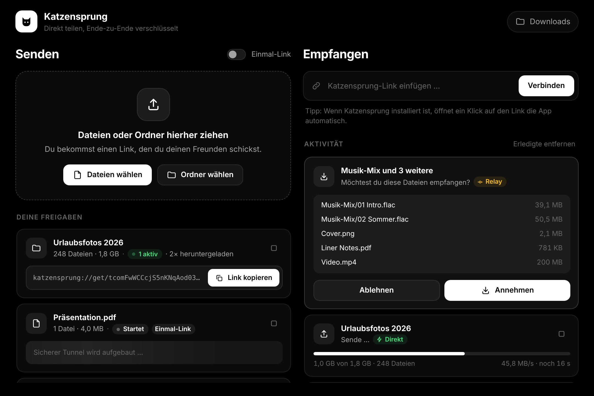

# Katzensprung 🐈



Dateien und Ordner direkt von PC zu PC teilen, mit Freunden oder zwischen
deinen eigenen Rechnern. Kein Account, keine Cloud, kein Upload-Limit.
Ende-zu-Ende verschlüsselt mit WireGuard.

Katzensprung ist eine Desktop-App (Windows, macOS, Linux). Sie baut auf
[tailcat](https://github.com/tailscale/tailcat) auf, also auf Tailscales
Datenebene, aber ohne Tailscale-Account oder Steuerungsebene.

## So funktioniert's

1. **Senden:** Ziehe Dateien oder Ordner ins Fenster. Alternativ wählst du
   sie über „Dateien wählen“ aus oder nutzt im Dateimanager „Öffnen mit
   Katzensprung“. Nach wenigen Sekunden erscheint ein Link wie
   `katzensprung://get/tcp…`.
2. **Link schicken,** zum Beispiel per Messenger oder E-Mail.
3. **Empfangen:** Dein Freund klickt auf den Link, und seine
   Katzensprung-App öffnet sich. Alternativ fügt er den Link in der App ein.
   Er sieht, welche Dateien kommen, und klickt auf **Annehmen**.
4. Die Dateien landen im Download-Ordner, den du oben rechts änderst.
   Vorhandene Dateien werden nie überschrieben, stattdessen heißt die
   neue Datei z. B. `foto (2).jpg`.

Ein Link funktioniert, solange die Freigabe läuft und die App des
Absenders geöffnet ist. Mit **Einmal-Link** endet die Freigabe nach dem
ersten vollständigen Download. Mit ⏹ beendest du eine Freigabe sofort.

### Verbindung

- Der Aufbau läuft über ein DERP-Relay (standardmäßig die kostenlosen
  tailcat-Relays). Danach versucht tailcat per NAT-Traversal, eine
  **direkte** Verbindung herzustellen. Die App zeigt das mit dem Abzeichen
  ⚡ **Direkt** bzw. **Relay** an.
- Alles ist mit WireGuard Ende-zu-Ende verschlüsselt. Auch das Relay sieht
  keine Inhalte.

### Sicherheit

**Der Link ist der Schlüssel:** Wer den Link hat, kann die Dateien
herunterladen, solange die Freigabe läuft. Teile ihn also nur privat und
beende Freigaben, die du nicht mehr brauchst.

Als Empfänger sicherst du dich so ab:

- Nichts wird gespeichert, bevor du **Annehmen** klickst.
- Dateinamen des Absenders werden bereinigt. Pfade wie `../` oder absolute
  Pfade werden abgelehnt.
- Geschrieben wird ausschließlich in den Download-Ordner (über Go's
  `os.Root`).

tailcat selbst bezeichnet sich als experimentell, siehe dessen
[SECURITY.md](https://github.com/tailscale/tailcat/blob/main/SECURITY.md).

## Installation

Fertige Builds für Windows (Installer und portable `.exe`), macOS
(`.app`) und Linux erzeugt der GitHub-Actions-Workflow
`.github/workflows/build.yml`.

Damit `katzensprung://`-Links die App öffnen, wird das Link-Schema
registriert:

| System  | Wie |
|---------|-----|
| Windows | Der Installer registriert es. Die portable `.exe` registriert sich beim ersten Start selbst für den aktuellen Benutzer (ohne Adminrechte). |
| macOS   | Über die `Info.plist` der App. Einmal öffnen genügt. Für Freunde muss die App signiert oder per Rechtsklick → Öffnen freigegeben werden. |
| Linux   | Beim ersten Start entsteht `~/.local/share/applications/katzensprung.desktop`, und `xdg-mime` setzt die App als Handler. |

## Entwickeln

Voraussetzungen: Go ≥ 1.27.2, Node 22, [Wails v2](https://wails.io)
(`go install github.com/wailsapp/wails/v2/cmd/wails@v2.17.1`). Unter Linux
brauchst du außerdem `libgtk-3-dev` und `libwebkit2gtk-4.1-dev`.

```bash
wails dev -tags webkit2_41
```

```bash
wails build -tags webkit2_41
```

Unter Windows und macOS entfällt `-tags webkit2_41`. Einen Windows-Build
samt Installer baust du auch von Linux aus:

```bash
wails build -platform windows/amd64 -nsis
```

Tests: Unit-Tests und ein End-to-End-Test über einen echten tailcat-Tunnel
mit lokalem Relay, ohne Internet:

```bash
go test -tags webkit2_41 ./...
```

### Eigenes Relay / Offline testen

`KATZENSPRUNG_DERPMAP_URL` zeigt auf eine eigene DERP-Map, z. B. für ein
[selbst betriebenes Relay](https://github.com/tailscale/tailscale/tree/main/cmd/derper#derp).
Zum lokalen Ausprobieren gibt es ein Entwickler-Relay:

```bash
go run ./tools/devderp
```

```bash
KATZENSPRUNG_DERPMAP_URL=http://127.0.0.1:8475/derpmap.json ./build/bin/katzensprung
```

## Aufbau

| Datei | Inhalt |
|-------|--------|
| `send.go` | Freigaben: tailcat-Server, Dateiliste, Senden |
| `receive.go` | Empfangen: tailcat-Client, Annehmen/Ablehnen, sicheres Speichern |
| `protocol.go` | Kleines Übertragungsprotokoll (Manifest → Annahme → Daten → Bestätigung), Pfadbereinigung |
| `link.go` | `katzensprung://get/<tailcat-Adresse>`-Links |
| `app.go` | Zustand, Fortschritt und Geschwindigkeit, Einstellungen, Dialoge |
| `register_*.go` | Registrierung des Link-Schemas pro Betriebssystem |
| `frontend/` | Oberfläche (Vanilla JS + Vite) |

Das Protokoll läuft auf TCP-Port 4747 innerhalb des WireGuard-Tunnels.
Der Absender schickt eine JSON-Zeile mit den Dateien, der Empfänger
antwortet mit Annahme oder Ablehnung. Danach folgen die Dateiinhalte am
Stück, und zum Schluss bestätigt der Empfänger mit einer JSON-Zeile, dass
alles gespeichert ist.
